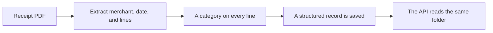

# Receipt Intelligence n8n

> See a category on every line, then ask spending questions in plain language.

[](https://github.com/RoxanaTapia/receipt-intelligence-n8n/actions/workflows/tests.yml)
[](LICENSE)
[](https://receipt-intelligence.roxanatapia.dev/)

🟢 **Live demo:** [receipt-intelligence.roxanatapia.dev](https://receipt-intelligence.roxanatapia.dev/)
▶ **Watch the demo:** [YouTube](https://youtu.be/m2YzXVfSf6c)
📄 **The case:** [Where did August go?](https://roxanatapia.dev/cases/receipts/)

[](https://youtu.be/m2YzXVfSf6c)

## The case

Corner Studio, a fictional studio, asks where the August snack money went. This repo is the reading step of Receipt Intelligence: workflows that open a receipt PDF, pull out the merchant, date, and line items, and put a spending category on each line. The [API](https://github.com/RoxanaTapia/receipt-intelligence-api) then adds the totals. The [visitor demo](https://github.com/RoxanaTapia/receipt-intelligence-demo) is where you try the three parts together.

## What it does

- 📄 Reads a receipt PDF
- 🔍 Pulls out the merchant, date, and line items
- 🏷️ Puts a spending category on each line
- 💾 Saves a structured record for each receipt

n8n runs the workflows.

## How it works



## For engineers

### Stack

n8n (Docker), Claude for extraction and categorization, and version-controlled workflow exports in this repo.

Each receipt is written as one JSON file under `data/receipts/`. The printed total is stored as a field. That is not a check of the line-item sum against the printed total.

After a file is saved, the ingest workflow asks the API whether that file is now in the loaded list. The workflow does not upload the JSON to the API. The file on disk is how the API gets the receipt.

### Quickstart

1. Clone this repo. Clone the [API repo](https://github.com/RoxanaTapia/receipt-intelligence-api) as well if you want the full local run.
2. Copy `.env.example` to `.env`, then start local n8n with `docker compose up -d`. Guide: [docs/n8n-setup.md](docs/n8n-setup.md).
3. Import [workflows/hello-world.json](workflows/hello-world.json) and run it once so you know the editor works.
4. Run the full path with a sample PDF: [docs/integration.md](docs/integration.md).

Docker Desktop (or Engine and Compose v2) is required. The full local run also needs Python 3.11 or newer for the API.

| Environment | Guide |
|-------------|-------|
| Local n8n | [docs/n8n-setup.md](docs/n8n-setup.md) |
| Local n8n and API | [docs/integration.md](docs/integration.md) |
| Hosted demo | [receipt-intelligence-demo](https://github.com/RoxanaTapia/receipt-intelligence-demo) |

### Automated tests

```bash
python -m unittest discover -s tests -v
python -m pip install ruff
ruff check .
ruff format --check .
```

GitHub Actions runs the automated tests and Ruff on every pull request and every push to main ([`.github/workflows/tests.yml`](.github/workflows/tests.yml)). Commands: [AGENTS.md](AGENTS.md).

### Project structure

| Path | What it holds |
|------|----------------|
| [`workflows/`](workflows/) | Version-controlled n8n exports, including [`receipt-pdf-ingest.json`](workflows/receipt-pdf-ingest.json) |
| [`samples/`](samples/README.md) | Public-safe PDF fixtures |
| [`data/`](data/README.md) | Receipt JSON store contract, and the runtime `data/receipts/` output |
| [`docs/`](docs/README.md) | Setup, extraction, categorization, and the API contract |
| [`tests/`](tests/) | Automated tests |
| [`.env.example`](.env.example) | Environment template. Never commit a filled file |

Start with the [docs index](docs/README.md) for reading order. Pipeline path: [PDF extraction](docs/pdf-extraction.md) → [categorization](docs/categorization.md) → [data store](data/README.md) → [setup contract](docs/n8n-setup.md#n8n--api-integration-contract) → [integration runbook](docs/integration.md). If you change this repo or run it locally, also see [docs/contributing.md](docs/contributing.md).

### Related repositories

| Repo | Role |
|------|------|
| **This repo** | PDF ingest, categorization, JSON on disk |
| [`receipt-intelligence-api`](https://github.com/RoxanaTapia/receipt-intelligence-api) | Totals, REST API, and spending answers |
| [`receipt-intelligence-demo`](https://github.com/RoxanaTapia/receipt-intelligence-demo) | Visitor UI and Compose demo that runs the workflows and the API together |

### How I build

I build with AI coding agents. Every change goes through a pull request I review and merge, with automated tests you can see on every change.

---

[MIT License](LICENSE) · [Roxana Tapia](https://github.com/RoxanaTapia) · [roxanatapia.dev](https://roxanatapia.dev)
