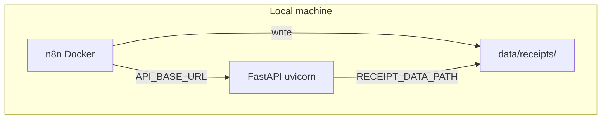

# Local full-stack integration runbook

**Module 5 (Integration)** — one place to start both apps, share the receipt folder, run a sample PDF, and see an API response in n8n.

📌 This is the **demo recipe**. Env details and node-level contract live in [n8n-setup.md](n8n-setup.md#n8n--api-integration-contract). API analytics and Q&A guides stay in the sibling repo — link only, do not duplicate.



## Out of scope

| Topic | Module |
|-------|--------|
| Cloud deploy, CI/CD, secrets at scale | **7 — Delivery** ([receipt-intelligence-demo](https://github.com/RoxanaTapia/receipt-intelligence-demo)) |

## Prerequisites

- Sibling clones under one parent folder (layout in [setup — shared disk](n8n-setup.md#n8n--api-integration-contract))
- [Docker Desktop](https://www.docker.com/products/docker-desktop/) for n8n
- Python 3.11+ for the API
- `ANTHROPIC_API_KEY` in **both** apps: n8n (Claude extract/categorize) and the API (`POST /questions`)

## 1. Start n8n + API

Confirm `RECEIPT_DATA_PATH` on the API points at this repo’s [`data/receipts/`](../data/README.md) — defaults are in the [API `.env.example`](https://github.com/RoxanaTapia/receipt-intelligence-api/blob/main/.env.example).

### n8n (Docker)

From `receipt-intelligence-n8n/`:

```bash
cp .env.example .env   # set N8N_BASIC_AUTH_PASSWORD and ANTHROPIC_API_KEY
docker compose up -d
```

UI: [http://localhost:5678](http://localhost:5678). Full steps: [n8n-setup.md](n8n-setup.md#quick-start).

### API (uvicorn)

From `receipt-intelligence-api/`:

```bash
python3 -m venv .venv
source .venv/bin/activate
pip install -r requirements.txt
cp .env.example .env   # confirm RECEIPT_DATA_PATH; set ANTHROPIC_API_KEY for Q&A
uvicorn app.main:app --reload
```

OpenAPI UI: [http://localhost:8000/docs](http://localhost:8000/docs). More: [API README](https://github.com/RoxanaTapia/receipt-intelligence-api#local-run).

## 2. `API_BASE_URL` for n8n in Docker

n8n inside Docker must reach the API on the host — use `API_BASE_URL=http://host.docker.internal:8000` (default in `.env.example`). Host curls use `http://localhost:8000`.

Details: [setup — reachability](n8n-setup.md#api_base_url-reachability).

## 3. Import, run, and read the API response in n8n

Disk is the ingest handoff; HTTP after persist is coverage smoke → analytics summary → fixed demo Q&A. We do **not** POST receipt JSON to the API for ingest — see [setup — contract](n8n-setup.md#n8n--api-integration-contract).

### Import and run

1. Import [`workflows/receipt-pdf-ingest.json`](../workflows/receipt-pdf-ingest.json) (see [Import a workflow](n8n-setup.md#import-a-workflow)).
2. Copy a [sample PDF](../samples/README.md) into the container:

   ```bash
   docker cp samples/receipts/03-small.pdf receipt-intelligence-n8n-n8n-1:/home/node/.n8n-files/03-small.pdf
   ```

3. **Execute workflow** in the n8n UI.
4. Confirm a hash-named JSON file under `data/receipts/` on the host ([data/README.md](../data/README.md)).

### What to open after a happy path

```text
Write File — Persist Receipt JSON
  → GET /health → GET /analytics/receipts → Code — Show Coverage Smoke
  → GET /analytics/summary → Code — Show Analytics Summary
  → POST /questions → Code — Show Demo Q&A Answer
```

| Check | Node / signal |
|-------|----------------|
| Coverage | **`Code — Show Coverage Smoke`**: `api_status` is `ok`, `persistedInCoverage` is `true` |
| Analytics | **`Code — Show Analytics Summary`**: `period_label`, `total_spend`, `top_categories`, … |
| Demo Q&A | **`Code — Show Demo Q&A Answer`**: `demo` is `true`, `answer` set (or `meta` refusal) |

Node-level walkthrough: [coverage](n8n-setup.md#post-persist-coverage-smoke) · [analytics](n8n-setup.md#post-persist-analytics-summary) · [demo Q&A](n8n-setup.md#post-persist-demo-qa) · [failure modes](n8n-setup.md#post-persist-failure-modes) (includes bounded HTTP retries).

## 4. Verification curls (host)

Run these on the **host** against `localhost:8000` while the API is up. Full guides: [analytics](https://github.com/RoxanaTapia/receipt-intelligence-api/blob/main/docs/analytics.md) · [Q&A](https://github.com/RoxanaTapia/receipt-intelligence-api/blob/main/docs/question-answering.md#setup-and-curl).

```bash
curl http://localhost:8000/health
# {"status":"ok"}

curl "http://localhost:8000/analytics/receipts"
# coverage: loaded_files should include the JSON n8n just wrote

curl "http://localhost:8000/analytics/summary?preset=last_N_days&n_days=90"
# period_label, total_spend, top_categories, …

curl -s http://localhost:8000/questions \
  -H 'Content-Type: application/json' \
  -d '{"question":"How much did I spend on food last month?"}'
# needs API ANTHROPIC_API_KEY — same fixed question as the demo node
```

## Related docs

| Doc | Role |
|-----|------|
| [Docs index](README.md) | Reading order |
| [n8n-setup.md](n8n-setup.md) | Docker n8n, env vars, integration **contract** |
| [pdf-extraction.md](pdf-extraction.md) | PDF → extract pipeline |
| [categorization.md](categorization.md) | Categorize → persist |
| [samples/README.md](../samples/README.md) | Sample PDFs for the demo |
| [data/README.md](../data/README.md) | Receipt JSON store |
| [API analytics](https://github.com/RoxanaTapia/receipt-intelligence-api/blob/main/docs/analytics.md) | Analytics setup and curls |
| [API Q&A](https://github.com/RoxanaTapia/receipt-intelligence-api/blob/main/docs/question-answering.md) | `POST /questions` setup and curls |
